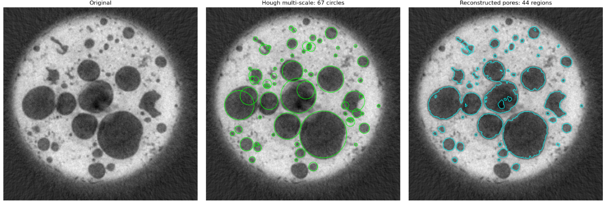
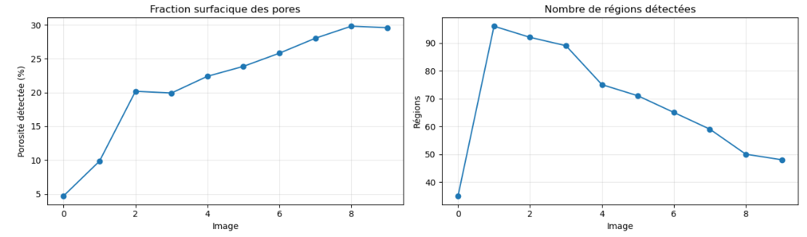
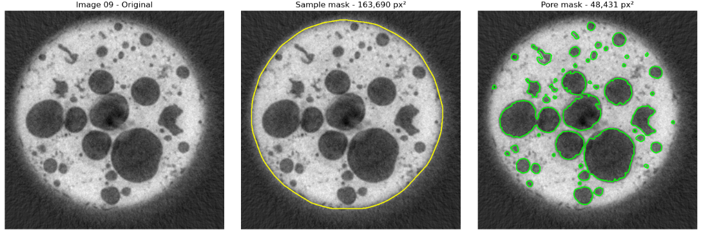

# Metal Foam Porosity — Multi-scale Hough & Region Reconstruction

A computer-vision research project that goes beyond circle detection to estimate **2D pore area fraction** in metallic-foam tomography.

## Highlights
- **Multi-scale Hough transform** detects small and large pore candidates.
- **Contrast filtering + circle IoU-NMS** reduce false detections and duplicate circles.
- **Convex specimen mask** restores peripheral pores excluded by an indented threshold mask.
- **Intensity-guided region growing + connected components** reconstruct irregular pore boundaries and group overlapping circle hypotheses.
- **Morphological and quantitative analysis** across 10 representative TIFF stacks.

## Visual results

### From Hough circles to reconstructed pore regions



*Illustrative intermediate experiment: 67 Hough circles and 44 reconstructed regions on slice 09. These counts differ from the final pipeline's recorded 73 circles and 48 regions.*

### Estimated 2D porosity across ten slices



*The slice index is not a time axis. Results are segmentation-based estimates, not validated 3D porosity measurements.*

### Specimen and pore masks



*Example from slice 09, illustrating the specimen boundary and the pore mask used to calculate area porosity.*

## Notebooks
| Notebook | Purpose |
|---|---|
| [`01_pore_segmentation_pipeline.ipynb`](01_pore_segmentation_pipeline.ipynb) | **Main runnable pipeline**, visualizations, diameter/center distributions, 2D porosity |
| [`02_experimental_journey.ipynb`](02_experimental_journey.ipynb) | **Empirical appendix**, experiments 1–29, discarded approaches, design choices and limitations |

## Quick start
1. Clone/download this repository and open the first notebook in Jupyter.
2. Put your `.tif` files inside an `input/` directory at the repository root.
3. Run the first notebook from top to bottom. The setup cell is:

   ```python
   %pip install numpy pandas matplotlib scipy scikit-image tifffile
   ```

4. If Jupyter has just installed dependencies, restart the kernel and run all cells.

The original TIFF data are **not included**; the analysis requires your own authorized dataset. The notebook takes the **middle slice of each TIFF stack**, not the full 3D volume.

## Recorded experimental results
The ten analyzed slices produced **35–96 connected regions per slice** and estimated **2D area porosity of 4.70–29.80%**. These are segmentation-derived estimates, not ground-truth measurements. Counts of circles and regions refer to different objects.

## Limitations
Some small pores remain undetected, and intensity-guided region growing can join neighboring pores incorrectly (especially on slice 02). No manually annotated benchmark has been used to quantify accuracy. Cross-section indices are **not** a demonstrated time axis. Convex specimen geometry is an assumption.

## Project context
Developed as a scientific imaging exercise. The study was extended beyond the initial Hough-based circle detection to address an additional objective suggested during class: **group detections by actual pore regions**.

## License and data
Code is provided for educational/research reuse. Verify data ownership and permissions before uploading TIFF stacks. No dataset is redistributed in this repository.
